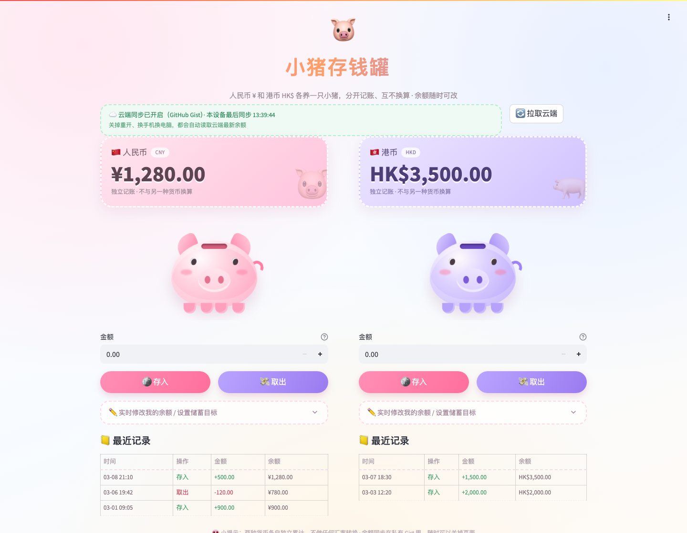

# 🐷 小猪存钱罐 Cute Piggy Bank

一个可爱风格的 Streamlit 存钱罐网页：



- 💴 **人民币 ¥** 和 **港币 HK$** 各一只小猪，**分开记账，互不换算**
- ✏️ 余额可以**实时手动修改**（输入框里改，松手立刻生效）
- 🪙 **存钱动画**：金币从天而降掉进小猪的投币口，小猪开心弹跳 + 飘出 `+¥xx`
- 💸 **取钱动画**：小猪抖动，金币从投币口蹦出来掉到地上 + 飘出 `-¥xx`
- ☁️ **云端永久保存**：余额存在自己的私有 GitHub Gist 里，**关掉重开、换手机换电脑都是同一份数据**
- 🎯 可选储蓄目标 + 进度条，📒 每个币种各自的最近流水记录

---

## ⚠️ 先看这里：为什么一定要配云端同步？

Streamlit 云端每个访问者都是**独立会话**，容器里的文件会随重启/休眠被还原。
所以如果**不配置云端同步**，就会出现「存了钱，关掉再开就变 0 / 换设备看不到」。

配置方法就是本文 **第四步**（生成一个 GitHub token，填到 Streamlit 的 Secrets 里），一分钟搞定。
没配置也能用，但数据只在当前这次会话里有效。

---

## 一、文件说明

| 文件 | 作用 |
| --- | --- |
| `piggy_bank_app.py` | 主程序（整个网页都在这里） |
| `requirements.txt` | 依赖包（只有 streamlit） |
| `README.md` | 本说明 |
| `preview.png` | 页面预览图（README 里显示用，可不传） |
| `.streamlit/secrets.toml.example` | 云端同步的密钥模板（本地用，可不传） |
| `piggy_state.json` | 运行时的本地缓存（自动生成，**不要传**） |

## 二、上传到 GitHub

1. 打开 https://github.com/new 新建仓库（名字比如 `piggy-bank`），选 **Public**，点 **Create repository**。
2. 点 **uploading an existing file**（或 `Add file` → `Upload files`）。
3. 把 **`piggy_bank_app.py`、`requirements.txt`、`README.md`** 拖进去
   （想带上 `preview.png` 也可以；`piggy_state.json` 千万不要传）→ 点 **Commit changes**。

> 已经有仓库、只想更新代码的话：在仓库里点开 `piggy_bank_app.py` → 右上角铅笔图标 →
> 全选删掉、粘贴新代码 → **Commit changes**，Streamlit 会自动重新部署。

## 三、部署到 Streamlit Cloud

1. 打开 https://share.streamlit.io ，用 **GitHub 账号登录**并授权。
2. 点 **Create app** → **Deploy a public app from GitHub**，填：
   - **Repository**：`你的用户名/piggy-bank`
   - **Branch**：`main`
   - **Main file path**：`piggy_bank_app.py`
3. 点 **Deploy!**，等 1～2 分钟，就会得到网址 `https://xxxxxxxx.streamlit.app`。

## 四、开启云端永久保存（关键一步）

**1）生成一个 GitHub 令牌**

- 打开 https://github.com/settings/tokens → **Generate new token (classic)**
- **Note** 随便写，比如 `piggy bank`
- **Expiration** 建议选 **No expiration**（否则过期后同步会失效）
- 权限只勾 **`gist`** 这一项，其它都不用勾
- 拉到底点 **Generate token**，复制那串 `ghp_` 开头的字符

**2）填进 Streamlit 的 Secrets**

- 在 Streamlit 应用页面右下角 **Manage app**（或右上角 ⋮ 菜单）→ **Settings** → **Secrets**
- 粘贴下面内容（把 token 换成你自己的），点 **Save**：

  ```toml
  [gist]
  token = "ghp_你复制的那串"
  ```

**3）重启应用**

- 右上角 ⋮ → **Reboot app**（或 Manage app → Reboot）

刷新页面后，标题下面会出现绿色的
「☁️ 云端同步已开启（GitHub Gist）」，说明成功了。

- 第一次运行会自动在你的 GitHub 里新建一个**私有 Gist** 存放数据（名字长得像 `piggy_state.json`）。
- 以后每存一笔钱都会立刻写进云端；换设备打开会自动读取云端最新余额。
- 页面上有个 **🔄 拉取云端** 按钮，可以手动重新读取云端数据。
- **这个 token 相当于你 GitHub 的一把小钥匙，只贴在 Streamlit 的 Secrets 里，不要写进代码、不要上传 GitHub。**

## 五、本地运行（可选）

```bash
pip install -r requirements.txt
streamlit run piggy_bank_app.py
```

想在本地也同步云端，就在项目里新建 `.streamlit/secrets.toml`（可从
`.streamlit/secrets.toml.example` 复制），填上同样的两行。该文件已被 `.gitignore` 忽略，不会上传。

## 六、常见问题

- **页面显示「云端同步出错：GitHub 令牌无效或已过期」**：token 复制错了 / 没勾 `gist` 权限 / 已过期，重新生成一个再填。
- **两台设备同时开着，谁说了算？** 每次操作前程序都会先从云端拉一次最新数据，所以不会把另一台刚存的钱覆盖掉；
  但如果两边**在同一秒**分别操作，以最后写入的那次为准。想立刻刷新，点 **🔄 拉取云端**。
- **想换颜色**：`piggy_bank_app.py` 里最上面的 `CURRENCIES` → `theme` 改色值。
- **想改文案**：直接搜中文提示语即可，都写了注释。
- **不想用 Gist 了**：把 Streamlit Secrets 里的内容删掉重启，程序会自动退回本地文件存储。
